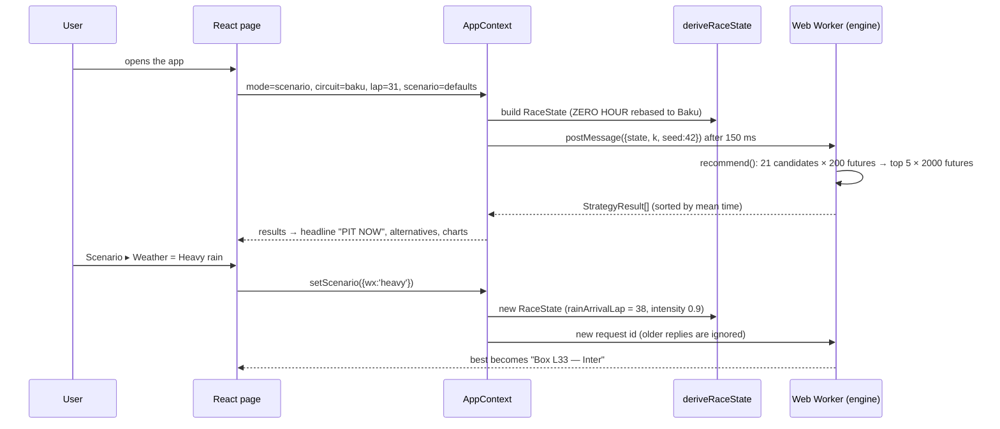

# PITWISE — The Whole Project, Explained

*An evidence-based audit and beginner's guide to the code in this repository.*

- **Repository state audited:** commit `cc60b5b` on `main` (identical to `origin/main` at audit time, 15 Oct 2026).
- **Method:** I read every source file under `src/`, `api/`, `server/` and `scripts/`, then ran the tests, type check, linter, production build, and a separate verification script that executed the real engine and API handlers. Nothing in the application was modified.
- **How to read the status labels:** see [§3](#3-what-actually-works-today). "Verified" always means I ran something and saw the result, not just that code exists.

> **A note on who wrote this.** The same assistant that wrote most of this code also wrote this audit. To keep that honest, every important claim below is tied to a file and line number. Wherever possible it is also tied to a command whose output is quoted in the [Evidence Appendix](#25-evidence-appendix).

---

## Table of contents

1. [Executive summary](#1-executive-summary)
2. [What PITWISE does and why it matters](#2-what-pitwise-does-and-why-it-matters)
3. [What actually works today](#3-what-actually-works-today)
4. [Page-by-page feature guide](#4-page-by-page-feature-guide)
5. [Step-by-step user workflows](#5-step-by-step-user-workflows)
6. [Technology stack](#6-technology-stack)
7. [Architecture](#7-architecture)
8. [Data sources and provenance](#8-data-sources-and-provenance)
9. [Every formula — index and explanations](#9-every-formula--index-and-explanations)
10. [The race-strategy engine](#10-the-race-strategy-engine)
11. [Tyres, fuel, weather, Safety Car and rivals](#11-tyres-fuel-weather-safety-car-and-rivals)
12. [Monte Carlo simulation](#12-monte-carlo-simulation)
13. [Historical replay and timeline](#13-historical-replay-and-timeline)
14. [Telemetry and lap comparisons](#14-telemetry-and-lap-comparisons)
15. [3D car and circuit visualisation](#15-3d-car-and-circuit-visualisation)
16. [APIs, backend and storage](#16-apis-backend-and-storage)
17. [Security and configuration](#17-security-and-configuration)
18. [Testing results](#18-testing-results)
19. [Production readiness and deployment](#19-production-readiness-and-deployment)
20. [Limitations, inaccuracies and unfinished work](#20-limitations-inaccuracies-and-unfinished-work)
21. [Source-code learning guide](#21-source-code-learning-guide)
22. [Glossary](#22-glossary)
23. [Twenty judge questions with honest answers](#23-twenty-judge-questions-with-honest-answers)
24. [Final assessment and next steps](#24-final-assessment-and-next-steps)
25. [Evidence appendix](#25-evidence-appendix)

---

## 1. Executive summary

**PITWISE is a web app that helps a Formula 1 race engineer decide *when* to pit and *which tyre* to fit.** It does this by simulating the rest of the race many times for each option and comparing the average finishing times.

In one breath: you open the app, and it shows a race situation. By default this is the organisers' "ZERO HOUR" challenge: lap 31 of 53, P3, old Soft tyres, Safety Car out. The situation runs on Baku City Circuit parameters. Behind the scenes, a **Monte Carlo strategy engine** written in TypeScript runs in a background thread. It tests about 21 candidate strategies against 200 random "futures", keeps the best 5, and re-tests them against 2,000 futures. It then shows the winner as a big headline such as "PIT NOW · Box lap 31 · switch to Medium".

**What is genuinely real:**
- A working strategy engine with 8 passing unit tests.
- A recorded 2025 Azerbaijan GP (lap times, sectors, stints, pits) downloaded from the public OpenF1 API, used for replay.
- A pit-loss value (20.8 s) and base lap pace (1:44.2) fitted from that race.
- A real Baku outline built from OpenF1 car positions.
- An interactive 3D car (three.js).

**What is simulated or estimated (and labelled as such):**
- The whole ZERO HOUR scenario.
- The tyre-wear model (illustrative constants).
- Fuel load.
- Rain timing.
- Safety Car probability.
- Rival behaviour.
- Every "percentage" on the tyre cards.

**What is not there:**
- No live data feed. This is by design, and the page says so.
- The Telemetry and Weather & Track pages are placeholders.
- The backend API works when called directly, but **no page in the app calls it**.
- The app has **not been deployed**.
- The model has **never been back-tested** against real race outcomes.

**The most important things to know:**
- The engine ranks strategies **only by our own car's average remaining time**. Rival cars affect the displayed position and podium numbers, but they never change which strategy wins. *(Verified: removing all rivals gives the same ranking.)*
- With Baku's Safety Car assumption of 3% per lap, about **46% of simulated futures contain a new Safety Car**. That makes the spread of outcomes about 200 s, so **every strategy is labelled "High" risk**. *(Verified.)*
- The explanation sentence about tyre wear uses a simpler formula than the engine. It says "~2.9 s/lap" where the engine actually uses 5.5 s/lap. *(Verified.)*

---

## 2. What PITWISE does and why it matters

### 2.1 For someone who has never heard of it

Imagine a long running race where you must stop once to change your shoes. New shoes make you faster, but stopping costs you 20 seconds. If you stop too early, your new shoes wear out before the finish. If you stop too late, you lose time running on worn shoes. And sometimes the race is paused behind a slow "safety car". Everyone slows down then, so stopping costs much less.

PITWISE is a calculator for that decision in Formula 1. A race engineer asks: *"Do I call my driver into the pits now, in two laps, or never? And which tyre do I put on?"* PITWISE answers: *"Under our model, pitting now for Mediums is best by about 3.4 seconds on average. Here is the range of outcomes and why."*

### 2.2 Who would use it, and the decision it supports

| Person | Their question | What PITWISE gives them |
|---|---|---|
| Race strategist / engineer | "Box now or stay out? Which compound?" | Ranked list of pit options with average time, spread and risk |
| Team analyst after the race | "Was our call right?" | Replay of a recorded race and a "Post-Race Review" panel |
| Hackathon judge | "Is the advice grounded?" | Provenance labels on every value, plus an editable Assumptions panel |

### 2.3 What makes it different from a normal race dashboard

A normal dashboard **shows** what is happening (lap, position, gaps). PITWISE also **simulates what could happen** under each choice and **ranks the choices**. It also labels where every number came from: *recorded*, *fitted*, *simulated input* or *model estimate*.

### 2.4 The lap-31 example, and what the app really supports

The challenge scenario: 53-lap race, lap 31, running P3, ageing tyres, Safety Car out, rain possibly coming.

| Choice in the example | Does the current code support it? | Evidence |
|---|---|---|
| Pit now | **Yes**: candidate "pit on current lap" | `src/engine/recommend.ts:16-26` |
| Stay out a few laps | **Yes**: pit laps up to 9 laps ahead | `recommend.ts:11` (`last = min(currentLap+9, totalLaps-1)`) |
| Never pit | **Yes**: one "no-stop" candidate | `recommend.ts:27` |
| Wait for the rain | **Partly**: Intermediates are offered if rain is ≤10 laps away, but only as a single stop. There is no "dry tyre now, then Inters later" two-stop plan | `recommend.ts:13-14` |
| Choose Wet tyres | **No**: Wet is never generated as a candidate, even in heavy rain *(verified)* | audit output §25.3 |
| Two-stop strategies | **No**: every candidate has at most one stop | `src/engine/types.ts:35` (`pitLap:number\|null`) |

### 2.5 Recommendation ≠ guarantee

PITWISE says *"under our model, option A finishes 3.4 s sooner **on average** across 2,000 imagined futures"*. That is not a promise.
- In some futures option B wins.
- The futures themselves come from assumptions (tyre wear rates, rain timing, Safety Car chance) that **have not been checked against real race outcomes** (see [§20](#20-limitations-inaccuracies-and-unfinished-work)).

If an assumption is wrong, the ranking can be wrong. That is why the Assumptions panel lets you change every constant and watch the answer move.

---

## 3. What actually works today

**Status labels used in this report**

| Label | Meaning |
|---|---|
| ✅ **Verified** | Code inspected **and** behaviour confirmed by running it (tests, script, build or screenshot) |
| 🟡 **Implemented, not runtime-verified** | Code exists and looks correct, but I did not execute that exact path in this audit |
| 🟠 **Partial** | Only part of the intended behaviour exists |
| 🔵 **Simulated / mock by design** | Uses hypothetical or generated values, clearly labelled |
| ⚪ **UI only / placeholder** | A screen exists but no logic behind it |
| ⚙️ **Configured, unverified** | Settings or code exist, but no real connection was confirmed |
| ❌ **Not implemented** | Absent |
| ⛔ **Blocked** | Could not verify (credentials, environment, etc.) |

Screenshots of the Dashboard, Simulator, Live, Tyre Analysis and Compare pages were taken with headless Chrome **earlier in this same working session**. They were not re-taken during this audit. Items relying only on those screenshots are marked "verified (session screenshot)".

### 3.1 Headline feature status

| Feature | Status | One-line truth |
|---|---|---|
| Strategy engine (candidates → Monte Carlo → ranking) | ✅ Verified | 8 unit tests pass; audit script reproduced rankings and timings (≈91 ms in Node) |
| Recommendation panel + explanation text | ✅ Verified | Works; the explanation's tyre-wear number uses a simpler formula than the engine (F14) |
| Scenario controls (weather, rain timing, SC, wear, tyre age) | ✅ Verified | Each control changes the engine input; heavy rain switches the recommendation to Inters |
| Historical replay (2025 Azerbaijan GP) | ✅ Verified (state + no-future-leak) | Real OpenF1 laps; future laps provably unused |
| Replay play/pause/speed | 🟡 Implemented, not runtime-verified | `setInterval(…, 3000/speed)` |
| Post-Race Review | 🟡 Implemented, not runtime-verified | Re-runs the engine one lap before each recorded stop |
| Baku calibration (pit loss, base pace) | ✅ Verified (values) | Fitted by `scripts/calibrate.mjs`; tyre-wear fit not applied by default |
| Baku real outline / sector map | ✅ Verified (session screenshot) | From OpenF1 `/location`; coloured only in replay |
| 3D car (three.js, RB22 GLB) | ✅ Verified (session screenshot) | Rotates, zooms; tyre cards bound to wheels |
| Tyre Analysis page | ✅ Verified (session screenshot) | All numbers from engine functions |
| Compare Strategies page | ✅ Verified (session screenshot) | What-if drives the real engine |
| Strategy Simulator page | ✅ Verified (session screenshot) | Same engine, presets |
| Live Data page | 🔵 By design: "No live feed connected" | Never fetches anything |
| Telemetry page | ⚪ Placeholder | "Under construction" |
| Weather & Track page | ⚪ Placeholder | "Under construction" |
| Race History | 🟡 Implemented | Shows only the Baku fixture + Load button |
| Settings (theme + Assumptions) | 🟡 Implemented | Theme persists in `localStorage` |
| Backend `/api/*` handlers | ✅ Verified (called directly) | All routes respond correctly… |
| …backend used by the UI | ❌ Not implemented | No `fetch` to `/api` anywhere in `src/` (verified by grep) |
| Vercel deployment | ⛔ Blocked | `vercel login` never completed; nothing deployed |
| Live OpenF1 feed | ❌ Not implemented | Requires an OAuth token; none configured |
| Model back-testing / validation | ❌ Not implemented | No code compares predictions with real outcomes |

---

## 4. Page-by-page feature guide

Routing lives in `src/App.tsx:20-28`. Every page sits inside the `Shell` layout (`src/components/Shell.tsx`), which provides:
- the sidebar,
- the top bar with page title, provenance pill, **Scenario** drawer button, theme toggle and avatar,
- the replay transport when in replay mode.

All pages read shared state through `useApp()` (`src/state/AppContext.tsx:34`).

### 4.1 Race Dashboard: `/`

**Purpose:** one screen with the race situation, the car, the recommendation and three charts.
**File:** `src/pages/Dashboard.tsx`

| Section | What it shows | Where the numbers come from | Status |
|---|---|---|---|
| Stat strip | Lap x/53 + progress bar, Position, Gap to leader, Weather, Track (SC/green), Sector map + deltas | `raceState` (derived); sector deltas only from recorded replay data (`StatRow.tsx:7-16`) | ✅ |
| 3D stage | RB22 car, four tyre cards with leader lines, orbit/zoom/reset buttons, CC-BY attribution | `Viewer.tsx`, `Stage.tsx`; tyre % = condition index (F16) | ✅ (session screenshot) |
| Hero line | "ZERO HOUR CHALLENGE GP · BAKU CITY CIRCUIT · LAP 31 OF 53" + summary sentence | `results[0]` | ✅ |
| Recommendation panel | Headline (PIT NOW / PIT IN n LAPS / STAY OUT), tyre photo, reason paragraph, est. remaining time, gain vs next best, uncertainty bars | `results`, `explain()` | ✅ |
| Alternatives | Up to 5 ranked options with radio, plan, delta, risk; click to plot | `results` | ✅ |
| Lap-time chart | Modelled lap times for the selected strategy and a comparison, with SC band, PIT and RAIN markers. Recorded laps are added in replay | F19 | ✅ (one-lap offset in the rain ramp, F19) |
| Tyre-degradation chart | % of modelled tyre life used vs age, per compound, with a "now" marker | F20 | ✅ |
| Weather chart | Chance of rain at +0/+5/+10/+20 laps | F21 | 🔵 Simulated |
| Circuit profile | Baku outline, published facts, fitted values and assumptions, each tagged | `CircuitProfile.tsx` | ✅ |
| Assumptions panel | Every engine constant editable; "Apply fitted tyre wear" | `Assumptions.tsx` | 🟡 |
| Post-Race Review (replay only) | Engine advice before each recorded stop | `PostRace.tsx` | 🟡 |

**Example:** at the default state, the dashboard reads "PIT NOW · Box lap 31 · switch to Medium" and "Gain vs next best 3.4 s". It also says High uncertainty, with a 5–95% spread of about 201 s (see [§10.4](#104-worked-example-with-the-real-numbers)).

### 4.2 Strategy Simulator: `/simulator`

**File:** `src/pages/Simulator.tsx`

- **Presets:** "ZERO HOUR challenge", "Dry baseline" (dry, SC clear) and "Wet gamble" (heavy rain, SC clear, high wear). A "Custom" pill appears when no preset matches (`Simulator.tsx:9-13`).
- **Conditions panel:** Weather, Rain arrives (1–15 laps; disabled when Dry), Safety Car, Tyre degradation, Tyre age (0–40). Every control calls `setScenario`, which changes `raceState`, which re-runs the engine.
- **Recommended panel and Strategies table:** remaining time, delta, risk. Clicking a row selects it for the charts.
- **Charts:** lap time and tyre degradation (same components as the Dashboard).
- **Status:** ✅. If you are in Replay mode, a warning explains that the simulator edits the scenario and offers to switch.

### 4.3 Live Data: `/live`

**File:** `src/pages/Live.tsx`. **Status:** 🔵 honest empty state.

- The page shows "No live feed connected" and explains that OpenF1 live data needs an OAuth token, which is not configured.
- **Retry** only changes a message (`Live.tsx:31`); it makes **no network request**.
- **Use simulated scenario** switches to scenario mode and opens the Simulator.
- **Analyse current race state** opens the Dashboard.
- The leaderboard, race-control, telemetry and stat cells are deliberately empty ("—"). No live data is invented.

### 4.4 Tyre Analysis: `/tyres`

**File:** `src/pages/TyreAnalysis.tsx` (ported from `PITWISE_Tyre_Analysis.html`, but its numbers come from our engine, not the design file's mini-model).

| Section | Calculation |
|---|---|
| Current tyre / stint age / degradation level / pace loss | `tyreLoss(cur, age)`; level thresholds 0.8 / 2.0 s (F24a) |
| Compound overview (5 Pirelli photos) | Selecting a compound updates the stats row: rate, loss at current age, loss at 30 laps, weather fit (F24c) |
| Degradation curves (0–40 laps, 0–8 s) | `degradation × DEG_MEAN_SCALE`, with a ±1σ band (F24b) |
| Individual tyres | Four corners: condition index (F16) and pace loss (F15) |
| Compound comparison (stint-length slider 5–20) | Stint cost = offset × N + Σ wear + penalty × N (F24d) |
| Weather and crossover | First lap where Inter beats the best slick, and Wet beats Inter (F23) |
| Pit-stop timing | Top 3 engine results, "stopping now vs staying out" (only when both are in the shortlist) |
| Assumptions & provenance | Collapsible list with tags (MODEL ESTIMATE / HISTORICAL FIT / …) |

**Status:** ✅ (session screenshot).

### 4.5 Compare Strategies: `/compare`

**File:** `src/pages/Compare.tsx` (ported from `PITWISE_Compare_Strategies(1).html`).

- **Context strip:** lap, position and gap, tyre, track, weather, objective.
- **Best modelled strategy:** headline, plan, explanation, remaining time, advantage, P5–P95 spread.
- **Ranked table:** rank, strategy, remaining, vs best, an outcome-range bar from P5 to P95 with a tick at the mean (F25), and risk.
- **Time vs best:** horizontal bars.
- **Strategy detail:** pit-lane time, outcome range, and "where the time differs" by component, using the **central-scenario breakdown** (F22). That breakdown is not the Monte Carlo mean, and the page says so.
- **What-if panel:** the same five scenario controls plus a "Normal pit loss" slider (15–35 s). It shows a verdict comparing the current best with the ZERO HOUR baseline, which is a second, smaller engine run of 100 + 400 futures on the main thread (`Compare.tsx:28-32`).
- **Status:** ✅ (session screenshot). The pit-loss slider writes a **global** override, which also affects other pages.

### 4.6 Race History: `/history`

**File:** `src/pages/History.tsx`. Shows only the focus-circuit fixture (Baku): name, laps, driver count, data gaps, and a **Load** button that switches to replay mode and opens the Dashboard. The Madrid, Monaco and Singapore fixtures are bundled but hidden. **Status:** 🟡.

### 4.7 Telemetry: `/telemetry` and Weather & Track: `/weather`

**Files:** `src/pages/Telemetry.tsx`, `src/pages/WeatherTrack.tsx`. **Status:** ⚪ **placeholders.** Each shows a title, a provenance badge and "Under construction — owned by …". They were reserved for teammates (`TEAMMATE_CONTRACT.md`).

### 4.8 Settings: `/settings`

**File:** `src/pages/Settings.tsx`. A theme switch, plus the Assumptions panel opened. **Status:** 🟡.

### 4.9 Scenario drawer (on every page)

**File:** `src/components/ScenarioDrawer.tsx`. Opened by the top-bar **Scenario** button. It contains:
- **Mode:** Scenario / Replay / Live.
- **Circuit:** fixed text "Baku City Circuit".
- **Controls:**
  - scenario mode: the five scenario controls;
  - replay mode: a driver selector and the tyre-degradation control.
- **Reset** button.

The amber dot on the button fills when any input differs from the defaults (`Shell.tsx:32`). Escape closes it.

---

## 5. Step-by-step user workflows

### 5.1 "What should we do right now?" (scenario mode, default)



**What happens if something fails?**
- If the worker throws, there is **no error handler**. `loading` would stay `true` and the panel would show "Recalculating strategies" forever (`useRecommendation.ts:13-21`). This was found by code inspection; the failure was not reproduced.
- If the 3D model fails, the viewer tries the GitHub copy. If that also fails, it shows "3D vehicle unavailable · Retry" (`Viewer.tsx:184-189`).

### 5.2 Replaying the real 2025 Azerbaijan GP

1. Open **Race History** and click **Load**, or open the drawer and choose Mode = Replay.
2. The lap is set to 40% of the race distance (lap 20 of 51) (`AppContext.tsx:56`).
3. `replayState()` keeps only laps ≤ current lap, rebuilds our car and the 5 nearest rivals, and the engine recommends.
4. The top bar shows play/pause, restart, ±1 lap, a scrubber, and 1× / 5× / 10× speed.
5. At the final lap, **Post-Race Review** enables. It shows, for each recorded stop, what the engine would have advised one lap earlier.

### 5.3 "How sure are we?"

- Look at the uncertainty line in the recommendation panel.
- Look at the P5–P95 bars on Compare.
- Change any constant in **Assumptions** and watch the ranking move.

---

## 6. Technology stack

All versions are taken from `package.json`. "Used?" was confirmed by searching the imports.

| Technology | Simple explanation | Actual project use | Evidence | Status |
|---|---|---|---|---|
| **TypeScript** (~6.0) | JavaScript with type labels that catch mistakes before running | All app, engine, server code; `strict: true` | `tsconfig.app.json` | ✅ `tsc -b` passes |
| **React 19** | Builds the screen from small reusable pieces ("components") | Every page and panel | `src/main.tsx`, `src/pages/*` | ✅ |
| **Vite 8** | Development server and production bundler | `npm run dev`, `npm run build`; bundles the Web Worker | `vite.config.ts` | ✅ build OK |
| **react-router-dom 7** | Maps URLs like `/tyres` to pages | 9 routes | `src/App.tsx:20-28` | ✅ |
| **three.js 0.186** | Draws 3D graphics in the browser with WebGL | RB22 car viewer, OrbitControls, GLTFLoader, RoomEnvironment | `src/components/dashboard/Viewer.tsx:2-5` | ✅ (session screenshot) |
| **lucide-react** | Icon set | Sidebar, buttons | `Shell.tsx:2` | ✅ |
| **Plain CSS + custom properties** | Colours and spacing as variables; dark/light themes | `tokens.css`, `app.css` | `src/styles/` | ✅ (no Tailwind) |
| **Google Fonts (Sora, Manrope)** | Typefaces | Loaded in `index.html` | `index.html` | 🟡 needs internet |
| **Web Worker** (browser feature) | Runs heavy maths on a second thread so the page doesn't freeze | Strategy engine | `src/engine/worker.ts`, `useRecommendation.ts:14` | ✅ (UI showed results) |
| **Vitest 5** | Test runner | 8 engine tests | `src/engine/__tests__/engine.test.ts` | ✅ 8/8 pass |
| **oxlint** | Linter (style and bug-pattern checker) | `npm run lint` | `package.json` | ✅ 0 errors, 24 warnings |
| **tsx** | Runs TypeScript directly in Node | Local API server `npm run dev:api` | `server/dev.mjs` | ✅ (used in audit) |
| **Node `http`** | Minimal web server | Dev API adapter on port 3001 | `server/dev.mjs` | 🟡 |
| **Vercel serverless function** | Hosting for `/api/*` in production | `api/[...route].ts`, `vercel.json` | | ⚙️ configured, never deployed |
| **OpenF1 public API** | Free F1 timing data (2023+) | Offline scripts only, not called at runtime | `scripts/fetchRace.mjs`, `fetchTrackOutline.mjs` | ✅ ran successfully earlier in this session; not re-run in this audit |
| **recharts 3** | Chart library | **Installed but not imported anywhere.** Charts are hand-written SVG | `grep recharts src` → nothing | ⚠️ unused dependency |
| Database / ORM | — | **None** | — | ❌ not used |
| Authentication | — | **None** | — | ❌ not used |
| FastF1 / Jolpica | — | **Not used** | — | ❌ |
| AI / machine learning | — | **None.** The engine is a hand-written simulation, not a trained model. The only "fitting" is simple medians and a least-squares slope in `calibrate.mjs` | — | ❌ |

---

## 7. Architecture

### 7.1 Diagram of what really exists

```mermaid
flowchart LR
  subgraph Offline["Offline scripts (run once by a developer, Node)"]
    O1[OpenF1 public API] -->|laps, stints, pit, weather,<br/>race_control, drivers| S1[scripts/fetchRace.mjs]
    O1 -->|location x,y| S3[scripts/fetchTrackOutline.mjs]
    S1 --> J1[(src/data/baku.json<br/>+ madrid/monaco/singapore)]
    J1 --> S2[scripts/calibrate.mjs] --> J2[(baku.calibration.json)]
    S3 --> J3[(baku.outline.json)]
  end

  subgraph Browser["Browser (everything the user sees)"]
    UI[Pages & components] -->|user input| CTX[AppContext<br/>React state]
    CTX --> DRS[deriveRaceState]
    J1 -. bundled at build time .-> DRS
    J2 -. bundled .-> CTX
    J3 -. bundled .-> UI
    DRS -->|RaceState| HOOK[useRecommendation<br/>150 ms debounce]
    HOOK -->|postMessage| WK[Web Worker<br/>engine/recommend]
    WK -->|StrategyResult[]| CTX
    CTX --> UI
    UI --> V3D[three.js Viewer]
    GLB[(public/models/rb22.glb)] --> V3D
    GH[(GitHub raw copy)] -. fallback .-> V3D
  end

  subgraph Server["Server code (exists, unused by UI)"]
    API["api/[...route].ts (Vercel)<br/>server/dev.mjs (local :3001)"] --> H[src/server/handlers.ts]
    H --> REC[same engine/recommend]
    J1 -. bundled .-> H
  end

  UI -. "NO calls today" .-x API
```

### 7.2 The diagram in plain English

1. **Before the app runs**, a developer ran scripts that downloaded one real race per circuit from OpenF1 and saved it as JSON files inside `src/data/`. Another script measured pit loss and base pace from the Baku race. A third traced the Baku track shape.
2. **When you build the app**, those JSON files are packed into the JavaScript bundle. There is no database and no live download.
3. **In the browser**, `AppContext` stores your choices: mode, lap, scenario inputs and constant overrides. `deriveRaceState` turns them into a full race snapshot (`RaceState`).
4. That snapshot is sent to a **Web Worker** that runs the strategy engine. When the results come back, every panel redraws.
5. **The 3D car** is loaded separately from `/models/rb22.glb`, with a GitHub copy as fallback.
6. **The server code** is a second doorway to the same engine (`POST /api/strategy`) and the same data (`GET /api/race/baku`, …). It works when called directly, **but no page calls it today**. So the deployed app, once deployed, would not need it.

### 7.3 Quick answers

| Question | Answer |
|---|---|
| What runs in the browser? | All UI, the strategy engine (in a Worker), the 3D viewer, charts |
| What runs on a server? | Nothing is required. The optional API handlers run under Node / Vercel |
| Where does race data come from at runtime? | Bundled JSON files. No network calls except fonts and the 3D model |
| Survives a refresh? | Only theme and sidebar-collapsed state (`localStorage`). Scenario, lap, overrides and selections reset |
| Works offline? | Mostly. The engine, data and pages work. Google Fonts won't load; the 3D model works if `/models/rb22.glb` is served by the same server |
| Requires credentials? | No. The only credential-gated feature (OpenF1 live) is not built |

---

## 8. Data sources and provenance

### 8.1 Every source

| Source | Role | Fields used | Pages | Type | Auth | If unavailable |
|---|---|---|---|---|---|---|
| OpenF1 `/sessions`, `/laps`, `/stints`, `/pit`, `/weather`, `/race_control`, `/drivers` | Build the race fixture | lap number and duration, sector durations, compound, tyre age at stint start, pit laps, rainfall, temperatures, race-control messages, driver codes | Replay, History, sector map, lap chart "Observed" | Real historical | None (public, 2023+) | Script writes a **generated** race, labelled `SIMULATED` (`fetchRace.mjs:83-110`) |
| OpenF1 `/location` | Baku outline | x, y positions over lap 20 (driver 1, session 9904, 408 samples) | Sector map, circuit profile | Real historical | None | Falls back to a hand-drawn schematic (`CircuitMap.tsx`) |
| `src/data/baku.calibration.json` | Fitted constants | pitLossSec 20.76 (18 stops), basePaceSec 104.24 (929 laps), deg fits | Engine via `AppContext.tsx:75`, `deriveRaceState.ts:9` | Historical fit | — | Code falls back to `CIRCUITS.baku` assumptions |
| `src/state/zeroHour.ts` | The organisers' challenge snapshot | Lap 31/53, P3, tyre, fuel 38 kg, 4 rivals with gaps and plans | Scenario mode (default) | **Hardcoded hypothetical** | — | — |
| `src/engine/constants.ts` | Tyre model, pit loss, SC delta, fuel, noise | see F-index | Everything | **Illustrative assumptions** | — | — |
| `src/config.ts` `CIRCUIT_FACTS` | Length 6.003 km, 20 turns, 51 laps | Circuit profile | Published facts (typed in by hand) | — | — |
| `public/models/rb22.glb` (+ GitHub raw) | 3D car | — | Dashboard | Asset (CC BY 4.0, Dave Love) | — | Error card + Retry |

### 8.2 Data-provenance table (the important values)

| Value | Origin | Where shown | Real / simulated / hardcoded / estimated | Verified? |
|---|---|---|---|---|
| Lap 31 / 53, P3 | `ZERO_HOUR` | Stat strip | **Hardcoded hypothetical** (challenge) | ✅ |
| Lap & position in replay | Fixture, laps ≤ current | Stat strip | **Real**, but position is **derived** from cumulative lap times, not official timing (`fetchRace.mjs:46-51`) | ✅ state; position method by inspection |
| Tyre compound & stint age (scenario) | `ZERO_HOUR` + Tyre-age slider | Cards, charts | **Simulated input** | ✅ |
| Tyre compound & stint age (replay) | OpenF1 stints: `tyre_age_at_start + (lap − lap_start)` | Same | **Real** (derived) | ✅ |
| Tyre "condition %" | F16 | Tyre cards | **Model estimate**, not measured wear | ✅ hand-checked (17% FL) |
| Pace loss s/lap | F1 × corner factor (F15) | Cards, Tyre Analysis | **Model estimate** | ✅ |
| Fuel load | Scenario: 38 kg hardcoded. Replay: `(totalLaps − lap) × 1.75` | Engine only | **Estimate** (no real fuel data exists) | ✅ by inspection |
| Lap times (engine) | F3 | Charts, totals | **Model estimate** | ✅ |
| Lap times "Observed" (replay) | Fixture | Lap chart | **Real** | 🟡 |
| Sector deltas | Fixture S1–S3 of us − car at P1 on the same lap | Stat strip | **Real** (replay only), otherwise "Sector timing unavailable" | ✅ (e.g. NOR L20) |
| Weather now (scenario) | Dry / light / heavy control | Stat strip | **Simulated input** | ✅ |
| Weather (replay) | OpenF1 rainfall → wetness 0 or 0.5; weather sample picked by **lap ÷ total × samples**, not by timestamp | Engine, weather rows | **Real, approximately aligned** (see §20) | by inspection |
| Rain chance % | Normal CDF of the scenario's rain lap (F21) | Weather chart | **Model estimate** of a **simulated input** | ✅ by inspection |
| Track temp 28 °C (scenario) | `ZERO_HOUR` | Weather chart | **Hardcoded** (the app labels it SIMULATED INPUT) | ✅ |
| Safety Car now | Scenario toggle; replay: race-control regex | Stat strip, engine | Simulated / real-derived | ✅ |
| Future Safety Cars | 3%/lap random (F6) | Engine only | **Assumption** | ✅ (46% of futures) |
| Pit loss 20.8 s | Fitted from 2025 Baku | Everywhere | **Historical fit** | ✅ |
| Base pace 1:44.24 | Fitted | Engine | **Historical fit** | ✅ |
| Rival plans & cover probability | `ZERO_HOUR` (scenario) / all `null`, 0.3 (replay) | Engine only | **Hardcoded assumptions** | ✅ |
| Podium %, expected position | Engine histogram | Explanation, "finish P3" | **Model estimate** (depends on the weak rival model) | ✅ (shows 100% podium) |
| Telemetry (speed, throttle, …) | — | — | **Not available** | — |

**Where categories mix (risk):**
1. Scenario mode mixes **fitted Baku values** (pit loss, base pace) with a **hypothetical 53-lap race** (Baku's real race is 51 laps) and **illustrative tyre constants**. The UI labels the race SIMULATED, but a viewer could assume the tyre model is Baku-fitted. It is not.
2. Replay mode mixes **real lap/tyre state** with **assumed rival plans** (rivals never pit unless they "cover") and **estimated fuel**.
3. "Finish P3" and "P(podium) 100%" are **model-relative** numbers. They look precise but come from a simplistic rival model.

---

## 9. Every formula — index and explanations

### 9.0 Formula index

| # | Name | File : line | Affects recommendation? |
|---|---|---|---|
| F1 | Tyre degradation (piecewise linear with cliff) | `src/engine/lapTime.ts:5-7` | **Yes** |
| F2 | Weather penalty per compound | `lapTime.ts:8-13` | **Yes** |
| F3 | Lap time | `lapTime.ts:19-28` | **Yes** (core) |
| F4 | Pit-stop cost (with SC discount and noise) | `src/engine/simulate.ts:32` | **Yes** |
| F5 | Fuel effect and burn | `lapTime.ts:24`, `simulate.ts:39` | **Yes** |
| F6 | Random Safety Car laps | `src/engine/scenarios.ts:9-20` | **Yes** |
| F7 | Random rain-arrival lap | `scenarios.ts:21-22` | **Yes** |
| F8 | Random degradation scale | `scenarios.ts:23` | **Yes** |
| F9 | Wetness ramp | `scenarios.ts:30-36` | **Yes** |
| F10 | Finishing position | `simulate.ts:42-44` | No (display only) |
| F11 | Monte Carlo aggregation (mean, P5, P95, risk, podium) | `src/engine/recommend.ts:31-55` | **Yes** (mean ranks) |
| F12 | Delta to best (`medianDelta`) | `recommend.ts:64-65` | Display |
| F13 | Candidate generation rules | `recommend.ts:9-29` | **Yes** |
| F14 | Explanation "net gain per lap" | `src/engine/explain.ts:16-19` | No (text only, inconsistent with F1) |
| F15 | Per-corner pace loss & laps to drop-off | `src/state/deriveRaceState.ts:20-30` | No |
| F16 | Tyre condition index | `src/components/dashboard/Stage.tsx:22-27` | No |
| F17 | Gap to leader | `src/components/dashboard/StatRow.tsx:24-30` | No |
| F18 | Sector delta vs leader | `StatRow.tsx:7-16` | No |
| F19 | Lap-time chart series & axes | `src/components/charts.tsx:26-40,45` | No |
| F20 | Degradation chart normalisation | `charts.tsx:78` | No |
| F21 | Rain chance (normal CDF) | `charts.tsx:95-100` | No |
| F22 | Central-scenario time breakdown | `src/components/strategyMath.ts:28-44` | No |
| F23 | Crossover lap | `strategyMath.ts:49-54` | No |
| F24 | Tyre Analysis metrics (level, band, fit, stint cost) | `src/pages/TyreAnalysis.tsx:37,48-51,59,67` | No |
| F25 | Compare range bars & baseline run | `src/pages/Compare.tsx:28-32,65` | No |
| F26 | Calibration: pit loss, wear slope, base pace | `scripts/calibrate.mjs:20-59` | **Yes** (pit loss, base pace) |
| F27 | Fixture derivation (position, tyre age, wetness, SC, weather alignment) | `scripts/fetchRace.mjs:40-62` | **Yes** in replay |
| F28 | Degradation presets | `deriveRaceState.ts:12-16` | **Yes** |
| F29 | Scenario re-basing to Baku | `deriveRaceState.ts:32-53` | **Yes** |
| F30 | Replay fuel estimate | `deriveRaceState.ts:67` | **Yes** (replay) |
| F31 | Quantile index | `recommend.ts:31-33` | Yes (risk) |
| F32 | Random numbers (mulberry32 + Box–Muller) | `src/engine/rng.ts:1-16` | Yes (determinism) |
| F33 | Replay clock | `src/components/ReplayTransport.tsx:12` | — |
| F34 | Leader-line smoothing | `Stage.tsx:69-70` | — |
| F35 | Generated fallback race | `fetchRace.mjs:97` | Only for the Madrid fixture |

Unless stated otherwise, the worked examples use the **real default Baku scenario**: base pace 104.24 s, Soft 24 laps old, fuel 38 kg, pit loss 20.76 s.

---

### F1. Tyre degradation

1. **Purpose.** How many seconds per lap an old tyre loses compared with a brand-new one of the same type.
2. **Formula.**

   if age ≤ cliffLap: `loss = deg × age`
   else: `loss = deg × cliffLap + cliffDeg × (age − cliffLap)`

3. **Code.** `src/engine/lapTime.ts:5-7`
   ```ts
   return age <= m.cliffLap ? m.deg*age : m.deg*m.cliffLap + m.cliffDeg*(age-m.cliffLap);
   ```
4. **Symbols.**

   | Symbol | Meaning | Unit | Source |
   |---|---|---|---|
   | age | laps on this set | laps | car state |
   | deg | wear rate before the cliff | s/lap per lap | `TYRES` (`constants.ts:3-9`) |
   | cliffLap | lap where wear speeds up | laps | `TYRES` |
   | cliffDeg | wear rate after the cliff | s/lap per lap | `TYRES` |

   Values: Soft 0.12 / 16 / 0.45, Medium 0.07 / 26 / 0.30, Hard 0.04 / 38 / 0.20, Inter 0.09 / 22 / 0.35, Wet 0.05 / 30 / 0.25. **All are illustrative** (`ASSUMPTION_SOURCES['TYRES.*']`, `constants.ts:42`).

5. **Example.** Soft, 24 laps: 0.12 × 16 = 1.92, plus 0.45 × (24 − 16) = 3.60, total **5.52 s/lap**. *(The audit script printed 5.520.)*
6. **Effect.** It is part of every simulated lap (F3), so it is the main reason "pit now" wins: an old Soft is 5.5 s/lap slow.
7. **Limits.** Two straight lines, not a curve. The same for every circuit and temperature. No difference between front and rear tyres in the engine. Fitted Baku slopes (≈0.005–0.009) exist but are **not applied** by default.
8. **Verification.** ✅ Unit test 1 (monotonic and steeper past the cliff), test 3, and the script.

### F2. Weather penalty

1. **Purpose.** Extra seconds per lap from using the wrong tyre for how wet the track is.
2. **Formula** (w = wetness, 0 = dry, 1 = soaked):
   - Slicks: `45 × w²`
   - Inter: `12 × max(0, 0.35 − w) + 25 × max(0, w − 0.75)`
   - Wet: `18 × max(0, 0.60 − w)`
3. **Code.** `lapTime.ts:8-13`
4. **Symbols.** w comes from F9 (scenario) or the fixture (replay: 0 or 0.5).
5. **Example.** Light rain w = 0.35: slick 45 × 0.1225 = **5.51 s**, Inter **0**, Wet 18 × 0.25 = **4.5 s**. Heavy w = 0.9: slick **36.45**, Inter 25 × 0.15 = **3.75**, Wet **0**. *(Script output matches.)*
6. **Effect.** Makes Intermediates win in rain.
7. **Limits.** Hand-picked shape and numbers. Wet tyres would be better than Inters only above w ≈ 0.9, but Wet is never a candidate anyway (F13).
8. **Verification.** ✅ script.

### F3. Lap time (the core equation)

1. **Purpose.** Predict one lap for one car.
2. **Formula.**
   `lap = basePace + offset(c) + degradation(c, age) × degScale + fuelKg × SEC_PER_KG + weatherPenalty(c, w) + (underSC ? SC_LAP_DELTA : 0) + N(0,1) × PACE_SIGMA`
3. **Code.** `lapTime.ts:19-28`
4. **Symbols.**

   | Symbol | Meaning | Unit | Source |
   |---|---|---|---|
   | basePace | ideal lap, empty car, fresh reference tyre | s | Baku fit 104.24 (`deriveRaceState.ts:9`); rivals shifted from ZERO_HOUR |
   | offset(c) | compound's built-in slowness vs Soft | s | `TYRES` (Medium 0.55, Hard 1.15, Inter 4.5, Wet 9.0) |
   | degScale | this future's wear multiplier | — | F8 |
   | SEC_PER_KG | time per kg of fuel | s/kg | 0.033 (assumption) |
   | SC_LAP_DELTA | extra time behind Safety Car | s | 28.0 (assumption) |
   | PACE_SIGMA | random lap-to-lap scatter | s | 0.25 (assumption) |

5. **Example** (no noise, dry, no SC): 104.24 + 0 + 5.52 × 1 + 38 × 0.033 = 1.254, giving **111.014 s** *(script: 111.014)*. A fresh Medium on the next lap is 104.24 + 0.55 + 0 + 36.25 × 0.033 = 1.196, giving **105.99 s**: about **5 s/lap faster**.
6. **Effect.** It is summed over every remaining lap, for every car, in every simulated future.
7. **Limits.** No traffic, DRS, overtaking, track evolution or driver error. The SC adds the same 28 s to everyone without closing gaps (see §11.4).
8. **Verification.** ✅ tests 2 and 3, and the script.

### F4. Pit-stop cost

1. **Purpose.** Time lost by driving through the pit lane.
2. **Formula.** `pitCost = PIT_LOSS_BASE × (underSC ? SC_PIT_MULTIPLIER : 1) + pitNoise[stopIndex mod 4]`
3. **Code.** `simulate.ts:32`
4. **Symbols.** PIT_LOSS_BASE = 20.76 s (Baku fit, `AppContext.tsx:75`); SC_PIT_MULTIPLIER = 0.45 (assumption); pitNoise ~ N(0, 1.2 s) per future (F8 block).
5. **Example.** Under SC: 20.76 × 0.45 = **9.34 s** (± noise). Green flag: **20.76 s**. Pitting now under SC saves about 11.4 s.
6. **Effect.** This is why "pit now" wins when the SC is out.
7. **Limits.** The 0.45 factor is a guess. The same `pitNoise` value is shared by **all cars'** first stop in a given future. No pit-lane speeding, unsafe releases or double-stacking.
8. **Verification.** ✅ script (9.34).

### F5. Fuel effect and burn

1. **Purpose.** A heavier car is slower; it gets lighter every lap.
2. **Formula.** Lap-time term `fuelKg × 0.033`; after each lap `fuelKg = max(0, fuelKg − 1.75)`.
3. **Code.** `lapTime.ts:24`, `simulate.ts:39`
4. **Example.** 38 kg costs 1.254 s; one lap later, 36.25 kg costs 1.196 s. So the car gets **0.058 s/lap faster** from fuel burn.
5. **Limits.** Fuel is **never measured**. Scenario mode uses a hardcoded 38 kg; replay uses `(totalLaps − lap) × 1.75` (F30). Since every strategy burns the same fuel, fuel barely affects the ranking.
6. **Verification.** ✅ by hand and inspection.

### F6. Random Safety Car laps

1. **Purpose.** Imagine whether a new Safety Car happens later in the race.
2. **Rule.**
   - Laps `currentLap … currentLap + remaining − 1` are SC laps if an SC is active now.
   - On each later lap, with probability `scProbPerLap`, a new SC starts and lasts `3 + floor(U × 3)` laps (3–5).
3. **Code.** `scenarios.ts:9-20`; Baku `scProbPerLap = 0.030` (`constants.ts:23`, assumption).
4. **Example.** About 20 laps after the current SC ends: P(at least one new SC) ≈ 1 − 0.97²⁰ = **45.6%**. The audit measured **46.0%** of 2,000 futures.
5. **Effect.** Large: each extra SC adds 84–140 s to the race time, so the outcome spread is about 200 s and **every strategy shows "High" risk** (F11).
6. **Limits.** Not fitted (the 2025 race had only a lap-1 SC). SC laps may run past the last lap (harmless). SC doesn't bunch the field.
7. **Verification.** ✅ script.

### F7. Random rain-arrival lap

`rainLap = round(N(0,1) × rainArrivalSigma + rainArrivalLap)`, or none in the dry. `scenarios.ts:21-22`. Sigma is 4 laps (`zeroHour.ts:25`). **Example:** forecast lap 38 gives a rain lap usually between 30 and 46.

### F8. Random degradation scale and pit noise

`degScale = clamp(DEG_MEAN_SCALE + N(0,1) × DEG_UNCERTAINTY, 0.5, 1.6)`; `pitNoise[i] = N(0,1) × 1.2`. `scenarios.ts:23-24`. **Nominal:** mean 1.0, σ 0.15, so 95% of futures fall between 0.71 and 1.29 (the script saw 0.50–1.53 including outliers). This multiplies F1 in F3. **Unit test 3** guards that degScale actually increases lap time.

### F9. Wetness ramp

`t = (lap − rainLap) / 3`; wetness = wetnessNow if t ≤ 0, intensity if t ≥ 1, otherwise linear between them. `scenarios.ts:30-36`. **Example:** light rain (0.35) arriving lap 38 gives lap 38: 0, lap 39: 0.117, lap 40: 0.233, lap 41+: 0.35.

### F10. Finishing position

`position = rank of our total among the simulated cars + (startPosition − 1 − rivalsAheadAtStart)`, clamped to 1–20. `simulate.ts:42-44`. **Example:** P3 with 2 rivals ahead in the model gives offset 0; if we finish 2nd fastest of 5, we are P2. **Unit test 7** checks that a rival 18 s ahead at equal pace stays ahead. **It does not influence the ranking** (F11).

### F11. Monte Carlo aggregation

1. **Purpose.** Turn 2,000 simulated races into a few numbers.
2. **Formulas.**
   - `meanTime = Σ time_i / n`
   - P5 and P95 via F31
   - `spread = P95 − P5`
   - `risk = Low if spread < 8 s, Medium if < 18 s, else High`
   - `podiumShare = (#P1 + #P2 + #P3) / n`
   - `winShare = #P1 / n`
   - `expectedPosition = Σ position / n`
3. **Code.** `recommend.ts:35-55`; ranking by `meanTime` at `recommend.ts:60,63`.
4. **Example** (real default run): best mean 2,592.7 s, P5 2,531.5, P95 2,732.9, spread **201.4 s**, so **High**.
5. **Effect.** The mean decides the winner. Risk is display only.
6. **Limits.** The risk thresholds (8 s / 18 s) were chosen for quiet races. With random SCs, the spread is dominated by "how many SCs happen", which is the same for every strategy, so risk never discriminates (**all High in every tested setting**). Only with SC probability 0 did the audit see "Medium" (spread 10.3 s).
7. **Verification.** ✅ script.

### F12. Delta to best (`medianDelta`)

`delta_i = meanTime_i − meanTime_best`. `recommend.ts:64-65`. **The field name says "median" but it is a difference of means.** It is shown as "+3.4 s" and "Gain vs next best".

### F13. Candidate generation

- Pit laps `currentLap … min(currentLap + 9, totalLaps − 1)`.
- Compounds:
  - Medium and Hard always;
  - Inter if rain is ≤ 10 laps away or wetness > 0.2;
  - Soft if fewer than 15 laps remain.
- Plus one "no stop". At most 40 options.

`recommend.ts:9-29`. **Example:** default (dry, 22 laps left) gives 10 laps × {Medium, Hard} + 1 = **21 candidates** *(verified)*. Wet is never generated *(verified)*. There is no two-stop and no compound-rule check.

### F14. Explanation "net gain" (⚠ inconsistent)

`delta = (offset_new − offset_cur) − deg_cur × age`. `explain.ts:16-19`. It uses only the **pre-cliff** wear rate and ignores the cliff and degScale. **Example:** Soft 24 laps gives 0.12 × 24 = **2.9 s/lap** in the text, while F1 gives **5.52 s/lap**. The sentence therefore **understates** the case for pitting. It affects text only.

### F15. Per-corner pace loss & laps to drop-off

`loss_corner = degradation(compound, age) × f`, with `f = FL 1.1, FR 1.0, RL 0.85, RR 1.25`; `lapsToDropOff = max(0, round((cliffLap − age)/f))`; trend steep ≤ 5, rising ≤ 10. `deriveRaceState.ts:20-30`. The factors are **invented** to make corners differ. The code uses base `TYRES`, so edits in the Assumptions panel **do not** change corner values (inconsistency).

### F16. Tyre condition index

`condition% = clamp(100 × (1 − loss_corner / degradation(cliffLap + 12)), 0, 100)`; colour green > 60, amber 30–60, red < 30. `Stage.tsx:22-27`. **Example:** FL Soft 24 laps has loss 5.52 × 1.1 = 6.07. "End of life" is 0.12 × 16 + 0.45 × 12 = 7.32. Condition = 100 × (1 − 6.07 / 7.32) = **17%**, which matches the UI. It is a **modelled index, not measured wear**, and the tooltip says so.

### F17. Gap to leader

If every car ahead of us is in the model: `gap = −min(startOffsetSec of rivals ahead)`; P1 shows "Leader"; otherwise "—". `StatRow.tsx:24-30`. **Example:** Rival A at −18.4 s gives **+18.4 s**.

### F18. Sector delta vs leader (replay only)

`Δs_k = s_k(us) − s_k(car at P1 on the same lap)`, using the latest lap ≤ now with all three sectors. `StatRow.tsx:7-16`. **Example (real):** Norris, lap 20: **+0.090 / +0.206 / −0.269 s**. Verstappen led, so his read 0.000.

### F19. Lap-time chart

A deterministic series for the chosen strategy: F3 with σ = 0, degScale = DEG_MEAN_SCALE, no SC, pit loss excluded. `charts.tsx:26-40`. Axes are round(basePace) ± 6 s (`charts.tsx:45`). ⚠ The chart's rain ramp uses `(lap − r + 1)/3`, while the engine uses `(lap − r)/3`, so **the chart turns wet one lap earlier**. Verified at the rain lap: chart 0.117 vs engine 0.000.

### F20. Degradation chart

`wear% = min(100, degradation(c, age) × DEG_MEAN_SCALE / degradation(c, cliffLap + 12) × 100)`. `charts.tsx:78`. 100% means "modelled end of useful life", not physical wear.

### F21. Chance of rain

`P(rain by lap L) = Φ((L − rainArrivalLap) / σ)` using the Abramowitz–Stegun normal-CDF approximation; 0 in the dry, 100 if already wet. `charts.tsx:95-100`. **Example:** forecast lap 38, σ 4, at lap 41 gives Φ(0.75) ≈ **77%**. This is a **probability from a simulated input**, not a forecast; the caption says "rest simulated".

### F22. Central-scenario breakdown

For each remaining lap: base += basePace; tyre += offset + degradation × DEG_MEAN_SCALE; wx += penalty(centralWetness); fuel += fuel × 0.033; sc += 28 only on current-SC laps; pit += pit cost. `strategyMath.ts:28-44`. **Real example (best):** base 2397.5, tyre 30.4, wx 0, fuel 14.2, sc 84, pit 9.3, giving **2535.5 s**, versus the Monte Carlo mean of **2592.7 s**. The difference of about 57 s is mostly the random **future** SCs the breakdown ignores. Compare labels it as "central scenario".

### F23. Crossover lap

First lap where `offset(wetter) + penalty(wetter, w)` < the minimum over drier compounds of the same quantity (fresh tyres, rain as forecast). `strategyMath.ts:49-54`.

### F24. Tyre Analysis metrics

- **(a) Level:** Low < 0.8 s, Moderate < 2 s, else High (`TyreAnalysis.tsx:48`).
- **(b) Band:** `DEG_MEAN_SCALE × (1 ± σ)` (`:59`).
- **(c) Weather fit:** `penalty(c) − min penalty`: < 0.5 Suited, < 3 Marginal, else Poor, at the scenario's peak wetness (`:37,51`).
- **(d) Stint cost:** `offset × N + Σ_{a<N} degradation(a) × scale + penalty × N` (`:67`). **Example**, dry, N = 10, Soft: 0 + Σ 0.12a over a = 0..9 = 0.12 × 45 = **5.4 s**. Medium: 5.5 + 3.15 = 8.65, shown as **8.7 s**. Matches the screenshot.

### F25. Compare page

- Bar position `3 + (v − lo)/(hi − lo) × 94 %` across all strategies' P5..P95 (`Compare.tsx:65`).
- Baseline verdict re-runs `recommend` on the default scenario with 100 + 400 futures on the **main thread** (`:28-32`).

### F26. Calibration (offline)

- **Pit loss** = median of `(inLap + outLap − 2 × driver's median clean lap within ±5 laps)` over green-flag stops (`calibrate.mjs:20-29`). Result **20.76 s** from 18 stops (10th–90th percentile 19.2–23.6 s).
- **Wear slope:** for each stint of ≥ 8 clean laps, drop laps slower than median + 2.5 s, add back fuel gain (`lap × 0.0578`), then ordinary least-squares slope of time vs tyre age; take the median per compound, clamped to [0.005, 0.2] (`:33-55`). Result: **Hard 0.009, Medium 0.005** (the raw Medium median was ≈0.003, so it hit the floor). Track evolution confounds this, so it is **not applied by default**.
- **Base pace** = 25th percentile of `lapTime − (totalLaps − lap) × 1.75 × 0.033` over clean laps (`:58-59`), giving **104.24 s**.
- Verified: values match `baku.calibration.json`. The script was not re-run in this audit, because running it rewrites that file.

### F27. Fixture derivation (offline)

- **Position:** rank of cumulative lap time among drivers who completed that lap (`fetchRace.mjs:46-51`). This is not official classification and is sensitive to the skipped lap.
- **Tyre age** = `tyre_age_at_start + (lap − lap_start)` (`:60`).
- **Wetness** = 0.5 if rainfall else 0 (`:62`).
- **Weather sample** = `weather[floor(lap / total × count)]`, a **proportional mapping, not time-aligned** (`:52`).
- **SC laps:** race-control messages matching `SAFETY CAR|VIRTUAL SAFETY CAR`, excluding `ENDING|IN THIS LAP|CLEAR` (`:40`). For Baku 2025 this found **only lap 1**; not cross-checked against official records.

### F28. Degradation presets

Low / nominal / high set `DEG_MEAN_SCALE` = 0.85 / 1.0 / 1.2 and `DEG_UNCERTAINTY` = 0.15 × 0.75 / 1.0 / 1.35. `deriveRaceState.ts:12-16`.

### F29. Scenario re-basing to Baku

Every ZERO_HOUR pace is shifted by `104.24 − 92.0 = +12.24 s`. Total laps stay **53** (the challenge setting, not Baku's 51). Rain lap = `min(53, 31 + offset)`; intensity 0 / 0.35 / 0.9; SC lasts 3 laps when "Deployed". `deriveRaceState.ts:32-53`.

### F30. Replay fuel

`fuelKg = (totalLaps − lap) × 1.75`. `deriveRaceState.ts:67`. Pure estimate.

### F31. Quantile

`sorted[floor(q × (n − 1))]`, with no interpolation. `recommend.ts:31-33`.

### F32. Random numbers

mulberry32 (a small, fast seeded generator) and Box–Muller (turns two uniform numbers into one normal number). `rng.ts:1-16`. A seed of 42 makes the whole run repeatable. **Unit tests 4 and 8** check this. `Math.random` appears nowhere in the code *(grep verified)*.

### F33–F35

- **F33 Replay clock:** advance one lap every `3000 / speed` ms (`ReplayTransport.tsx:12`).
- **F34 Leader lines:** each frame moves 35% of the way to the wheel's screen position (`Stage.tsx:69-70`).
- **F35 Generated race** (Madrid fallback): `pace + offset + deg × age + fuel + SC 28 + uniform noise ± 0.25 + pit 21` (`fetchRace.mjs:97`), labelled SIMULATED.

---

## 10. The race-strategy engine

### 10.1 Answers to the fifteen questions

| # | Question | Answer (with evidence) |
|---|---|---|
| 1 | Inputs | `RaceState` (lap, totals, our car, rivals, wetness, rain lap, σ, intensity, SC, SC probability), constants `k`, seed (`recommend.ts:57`) |
| 2 | How options are made | Rule-based list (F13) |
| 3 | Pit now / delay / stay out? | Yes, yes (≤ 9 laps), yes |
| 4 | Compounds | One compound after the single stop: Medium, Hard, Inter (rain), Soft (< 15 laps left). No Wet |
| 5 | Pit cost | F4 |
| 6 | Safety Car | Current SC laps fixed; future SCs random (F6); SC laps +28 s and pit × 0.45 |
| 7 | Rain | Random arrival (F7), ramp (F9), penalty (F2) |
| 8 | Fuel | Yes, an estimated term (F5) |
| 9 | Rivals | Simulated with their own planned stops and a once-only "cover" chance; **they only affect position and podium numbers, not the ranking** |
| 10 | Remaining time | Sum of F3 per lap + F4, starting at `startOffsetSec` (0 for us) |
| 11 | Ranking | By mean remaining time over the futures |
| 12 | Selection | Stage 1: 21 candidates × 200 futures → keep 5. Stage 2: those 5 × 2,000 **new** futures → sort; first = recommendation |
| 13 | Explanation | Template sentences filled with numbers (`explain.ts`), not AI |
| 14 | Uncertainty | Yes: random SC, rain lap, wear scale, pit noise, lap noise; reported as P5–P95 and a risk label |
| 15 | Deterministic? | **Yes for a given seed (42)**; tests 4 and 8 pass |

### 10.2 Pseudocode

```text
recommend(state, k, seed=42):
  candidates = generateCandidates(state)              # ~21 options
  coarse = sampleScenarios(state, 200, seed)          # 200 random futures
  for each candidate: run it through all 200 futures → mean time
  shortlist = 5 lowest means
  fine = sampleScenarios(state, 2000, seed+1)         # 2,000 NEW futures
  for each of the 5: run through all 2,000 → mean, P5, P95, positions
  sort by mean; delta = mean − best mean
  return the 5 results

simulate one future for one option:
  for lap = current … last:
     for each car (us + rivals):
        decide pit (our plan / their plan / cover after our stop)
        if pit: add pit cost (F4); new tyres; age = 0
        add lap time (F3); age += 1; fuel −= 1.75
  our time = our total; our position = rank (F10)
```

### 10.3 It is a simulation, not AI

There is no learned model. "Fitting" means three simple statistics in an offline script (F26). It is an honest **Monte Carlo simulation with hand-set physics-style rules**.

### 10.4 Worked example with the real numbers

Default Baku scenario, seed 42. Audit run took **91 ms** in Node.

| Rank | Option | Mean remaining (s) | Δ to best | P5–P95 (s) | Risk | E[position] |
|---|---|---|---|---|---|---|
| 1 | Pit L31 · Medium | 2592.7 | — | 2531.5–2732.9 | High | 2.54 |
| 2 | Pit L32 · Medium | 2596.1 | +3.4 | 2534.3–2736.4 | High | 2.58 |
| 3 | Pit L31 · Hard | 2598.9 | +6.2 | 2538.8–2738.7 | High | 2.70 |
| 4 | Pit L33 · Medium | 2600.0 | +7.3 | 2537.5–2740.0 | High | 2.03 |
| 5 | Pit L32 · Hard | 2602.4 | +9.7 | 2541.7–2743.1 | High | 2.71 |

**Why L31 Medium wins, step by step.**
1. The current Soft is 8 laps past its cliff, losing 5.52 s/lap (F1).
2. Every extra lap on it costs ≈5 s versus a fresh Medium (F3 example).
3. The SC is out for laps 31–33, so a stop costs 9.34 s instead of 20.76 s (F4). L31, L32 and L33 all get the discount.
4. L31 wins by stopping the bleeding soonest.
5. Medium beats Hard because the 0.6 s/lap offset gap outweighs Hard's slower wear over 22 laps.

Note that row 4 has the **best expected position (2.03)** but ranks 4th, because ranking ignores position. See §20.

---

## 11. Tyres, fuel, weather, Safety Car and rivals

### 11.1 Tyres

- **Compounds.** Soft (red), Medium (yellow) and Hard (white) are dry slicks. Intermediate (green) is for damp tracks; Wet (blue) is for heavy rain. All five are modelled in F1 and F2, and all five have photos.
- **Tyre age vs wear.** The data and model know **how many laps** a tyre has done (stint age). They do **not** know physical wear (millimetres of rubber). Every "%" and every "s/lap loss" is **estimated** from age using F1.
- **Model shape.** Piecewise linear: a gentle slope, then a steeper slope after `cliffLap`. Hand-set, not learned.
- **Fresh vs old.** Fresh = age 0, so the loss is 0 and only the compound `offset` remains.
- **Rain.** F2 makes slicks very slow in the wet, so Inters win; the candidate rule only offers Inters if rain is ≤ 10 laps away.
- **Rates and origins.** See the F1 table: **illustrative**. The fitted Baku Medium/Hard slopes (0.005/0.009 s/lap per lap) are much lower. That would make "stay out" far more attractive, which is why they are opt-in (Assumptions → "Apply fitted tyre wear").

### 11.2 Pit stops

20.76 s fitted for Baku (F26), × 0.45 under SC (assumption), ± 1.2 s noise. It is circuit-specific (calibration, or `CIRCUITS` fallback), not race-state-specific. It is editable in Assumptions and on Compare's What-if slider.

### 11.3 Fuel

Never measured. Scenario: 38 kg (hardcoded, `zeroHour.ts:7`). Replay: inferred from laps remaining (F30). The effect is 0.033 s/kg; burn 1.75 kg/lap. Both are assumptions.

### 11.4 Safety Car

- **State.** Scenario: a toggle (3 laps remaining when on). Replay: the recorded lap flag from race-control text (F27).
- **Effects in the engine.**
  1. +28 s per SC lap for **every** car.
  2. Pit cost × 0.45.
  3. Random future SCs (F6).
- **What is missing.** Real SCs bunch the field together, erasing gaps. Here gaps are preserved, so an SC is modelled only as "cheap pit stop + slow laps". That understates the strategic swing.

### 11.5 Weather

- **Sources.** Scenario: user picks Dry / Light / Heavy and an arrival lap. Replay: recorded rainfall flag (Baku 2025 was dry: 0 wet laps). No forecast provider exists.
- **When a different tyre wins.** Through F2 inside the simulation. The display-only crossover lap (F23) helps explain it.

### 11.6 Rival behaviour

- **Scenario:** four hand-written rivals with planned stop laps and a "cover probability". Each rival rolls once, on the lap after our stop, to copy it (`simulate.ts:26-30`).
- **Replay:** the 5 cars closest in cumulative time, with **no planned stops** (`plannedPitLap: null`) and a cover chance of 0.3. So they only stop if they "cover" us.
- **Influence:** rivals change finishing position and podium share, but the **ranking does not depend on them**. Verified: same top-5 order with and without rivals.

---

## 12. Monte Carlo simulation

**Yes, it is implemented and runs** (✅ verified by tests and the audit script).

| Question | Answer |
|---|---|
| One run = | one imagined rest-of-race for one strategy, lap by lap, all cars |
| What changes between runs | new SC laps (F6), rain lap (F7), wear multiplier (F8), pit noise (F8), lap-to-lap noise (F3), rival cover rolls |
| How many | 200 (stage 1) and 2,000 (stage 2); `DEFAULTS.COARSE_SCENARIOS` / `FINE_SCENARIOS` (`constants.ts:15`), editable in Assumptions |
| Aggregation | mean, P5, P95, position histogram (F11) |
| Seed | 42 for stage 1, 43 for stage 2; per-future lap noise seeded `seed × 7919 + i` |
| Same futures for all strategies? | **Yes for the scenario pool** (one pool per stage, `recommend.ts:59,62`). ⚠ But the per-lap noise stream **diverges** between strategies once a rival's "cover" roll consumes an extra random number, so "common random numbers" are only partly kept. Effect is small (the audit saw 0.06 s on the mean) but real |
| Calibrated / back-tested? | **No.** Pit loss and base pace are fitted; nothing checks predicted vs real outcomes |

### Teaching example (illustrative only, NOT PITWISE output)

Five imagined futures, two options:

| Future | What happened | "Pit now" time | "Pit in 3 laps" time |
|---|---|---|---|
| 1 | nothing special | 100 | 104 |
| 2 | late Safety Car | 190 | 190 |
| 3 | tyres wear fast | 101 | 108 |
| 4 | tyres wear slow | 99 | 101 |
| 5 | rain early | 110 | 109 |
| **Average** | | **120.0** | **122.4** |

"Pit now" wins on average by 2.4, even though it lost future 5. The late SC in future 2 adds 90 to **both**, which is why it widens the spread (so risk reads "High") without changing who wins. That is exactly what happens in the real engine.

---

## 13. Historical replay and timeline

| Aspect | What the code does | Evidence | Status |
|---|---|---|---|
| Select race | History → Load, or drawer Mode = Replay; only Baku is offered | `History.tsx`, `ScenarioDrawer.tsx` | 🟡 |
| Load data | From the bundled JSON; no network | `data/fixtures.ts` | ✅ |
| Organisation | Flat list of `{lap, driverNumber, lapTimeSec, position, compound, tyreAge, pitThisLap, wetness, safetyCar, s1..s3}`. **No timestamps**: time is the lap number | `data/types.ts` | ✅ |
| Play / pause / speed | `setInterval` advances 1 lap per 3 s ÷ speed; stops at the last lap | `ReplayTransport.tsx:9-15` | 🟡 |
| Seek | Slider and ±1 buttons set `lap` | `ReplayTransport.tsx:18-22` | 🟡 |
| Dashboard updates | `lap` → `deriveRaceState` → engine | `AppContext.tsx:69-78` | ✅ |
| Race-control events | Only reduced to a per-lap SC flag; messages are not displayed | `fetchRace.mjs:40` | 🟠 |
| Missing data | Laps with no duration are skipped and listed in `meta.gaps`, which the Dashboard shows as a warning. No interpolation | `fetchRace.mjs:66-69`, `Dashboard.tsx` | ✅ |
| **No future knowledge** | `replayState` filters `timeline` to `lap ≤ current` before reading anything; the sector map and the "Observed" lap line do the same | `deriveRaceState.ts:57`, `StatRow.tsx:10`, `Dashboard.tsx` (`useObserved`) | ✅ **Verified**: state at lap 20 is byte-identical when all laps > 20 are deleted |
| Post-race review | Uses the whole race (recorded stops), enabled only at the final lap, titled "RETROSPECTIVE — uses the completed race" | `PostRace.tsx:11-17` | 🟡 |

**In-the-moment vs hindsight.** At lap 20 the engine only knows laps 1–20, the same as a real engineer. The Post-Race Review knows where everyone actually stopped. It is a report card, not a prediction, and is labelled that way.

One small leak: the **race distance** (51 laps) and the API route `/api/telemetry` (default `lap = 1e9`, so all laps) are not filtered. The distance is legitimately known in advance, and the API is not used by the UI.

---

## 14. Telemetry and lap comparisons

| Signal | Available? | Notes |
|---|---|---|
| Speed, throttle, brake, RPM, gear, DRS | ❌ **No** | Never fetched (OpenF1 `/car_data` is not used). The Telemetry page is a placeholder |
| Track position (x, y) | 🟠 Only for the **outline** | One lap of driver 1, used to draw the map; no moving car dots |
| Lap times | ✅ Real (replay) | "Observed" line on the lap chart |
| Sector times | ✅ Real (replay) | F18 deltas, sector-coloured map |
| Lap comparisons between drivers | ❌ | Not built |
| Telemetry annotations | ❌ | — |

`GET /api/telemetry/:circuit` returns **lap-level rows only** and says so in its `note` field (`handlers.ts:27-33`).

---

## 15. 3D car and circuit visualisation

| Question | Answer | Evidence |
|---|---|---|
| Real 3D? | **Yes**, an interactive WebGL model | `Viewer.tsx` |
| Library | three.js (WebGLRenderer, OrbitControls, GLTFLoader, RoomEnvironment) | `Viewer.tsx:2-5` |
| Asset | `/models/rb22.glb` (29 MB), fallback GitHub raw URL pinned to commit `bbc28fc`. "2026 Red Bull RB22" by Dave Love, CC BY 4.0; attribution shown | `Viewer.tsx:10-13`, `Stage.tsx` |
| Owner component | `Stage` (cards, lines, controls) → lazy-loaded `Viewer` (separate 641 kB chunk) | `Stage.tsx` |
| Rotate / zoom | Drag orbit, scroll zoom (distance 7–28), buttons: auto-rotate, −, +, reset | `Viewer.tsx:86`, `Stage.tsx` |
| Wheel hotspots | Found by **material names** matching `sidewall\|tyre\|tire`, grouped into 4 clusters; if not found, estimated from the bounding box | `Viewer.tsx:35`, `onModel` |
| Card ↔ wheel binding | Assigned once after load (higher wheels → top cards) and again on Reset view; never while orbiting | `Stage.tsx:56` |
| Data on the cards | The car's **state**: compound, stint age, modelled condition % (F16), pace loss (F15). In scenario mode this is simulated input + model estimate | `Stage.tsx` |
| Tyre colours from state? | The **photo and bar** reflect the compound and condition. The **3D tyres themselves are not recoloured** | inspection |
| Circuit map | Real Baku outline (OpenF1 positions); sector colours only from real replay deltas; static start dot, **no live car position** | `CircuitMap.tsx`, `baku.outline.json` |
| On failure | Same-origin → GitHub → "3D vehicle unavailable · Retry"; a React error boundary also catches crashes | `Viewer.tsx:184-189`, `Stage.tsx` |

Runtime: ✅ rendered and auto-rotated in headless Chrome earlier in this session (cards stayed bound for 24 s). Not re-run in this audit.

---

## 16. APIs, backend and storage

### 16.1 External API: OpenF1 (offline scripts only)

| Endpoint | Method | Used fields | Auth | Errors | Tested |
|---|---|---|---|---|---|
| `/v1/sessions?circuit_short_name&session_name=Race&year` | GET | session_key, year, country_name | none | 3 retries, back-off on 429; fallback to generated race | ✅ ran earlier this session (Baku, Monaco, Singapore OK; Madrid 404 → simulated) |
| `/v1/laps`, `/v1/stints`, `/v1/pit`, `/v1/weather`, `/v1/race_control`, `/v1/drivers` | GET | as in §8.1 | none | same | ✅ same run |
| `/v1/location` | GET | x, y, date | none | throws if < 50 samples | ✅ 408 samples |

No API key, no secrets.

### 16.2 PITWISE's own API (`src/server/handlers.ts`)

Called from: **nothing in the UI.** Adapters: `api/[...route].ts` (Vercel) and `server/dev.mjs` (local :3001; Vite proxies `/api` to it in dev).

| Route | Purpose | Audit result |
|---|---|---|
| `GET /api/health` | liveness | ✅ 200 |
| `GET /api/circuits` | circuit assumptions | ✅ 200, 4 circuits, `ESTIMATE` |
| `GET /api/race/:circuit` | full fixture | ✅ 200 `HISTORICAL`; unknown → 400 |
| `GET /api/weather/:circuit` | weather rows | ✅ 200 |
| `GET /api/telemetry/:circuit?lap&driver` | driver's lap rows ≤ lap | ✅ 200 (3 laps at lap = 3) |
| `POST /api/strategy` | run the same `recommend()` | ✅ 200 with a valid state; 400 if `state` missing; ⚠ **500** with `{}` as state, returning the internal error text |
| anything else | — | ✅ 404 |

Every response is `{data, provenance, generatedAt, source}`. No rate limiting, no caching, no auth. These tests called `route()` directly in Node. **The HTTP layers themselves (Vercel / Node server) were not exercised in this audit.**

### 16.3 Storage

| Question | Answer |
|---|---|
| Database? | **None** |
| What is saved? | `localStorage`: `pw.theme`, `pw.collapsed` only (`theme.ts:7,14`, `Shell.tsx:23,31`) |
| After refresh | Back to defaults: scenario mode, lap 31, default inputs, no overrides |
| Cache cleared | Theme returns to dark; nothing else lost |
| User scenarios | In memory only (React state) |
| Historical data | **Bundled** into the JS at build time (≈1 MB of JSON for four races) |
| Accounts / login | **None** |

---

## 17. Security and configuration

| Check | Finding |
|---|---|
| Secrets in code | **None found.** No API keys or tokens; no `.env` files; no `process.env` / `import.meta.env` usage *(grep verified)* |
| Environment variables required | **None** |
| Unsafe HTML rendering | No `dangerouslySetInnerHTML` / `innerHTML` *(grep verified)*. React escapes all text |
| Backend validation | ⚠ `POST /api/strategy` only checks that `state` exists. A malformed state gives a 500 that **echoes the JavaScript error message** (no stack trace). The body may also set `k.FINE_SCENARIOS` to any number, so a single request could force a very long computation (**denial-of-service risk** if deployed). Not exploitable today because nothing is deployed |
| CORS | Not configured (same-origin only). Fine for the current design |
| Auth | None. No user data exists, so none is needed today |
| Failed requests / error states | Worker errors are unhandled (stuck "Recalculating"); 3D load has a fallback and Retry; Live page is honest-empty |
| Third-party code at runtime | Google Fonts (CSS only). three.js is bundled, not loaded from a CDN |

---

## 18. Testing results

### 18.1 Commands actually run during this audit

| Command | Result |
|---|---|
| `npx vitest run` | ✅ **8 / 8 passed** (1 file, 157 ms) |
| `npx tsc -b` | ✅ **0 errors** |
| `npx oxlint` | ✅ exit 0, **0 errors, 24 warnings** (React fast-refresh export style, and "refs read during render" in `Stage.tsx` / `Viewer.tsx`) |
| `npm run build` | ✅ built. Chunks: main 997 kB (gzip 204 kB), Viewer 641 kB, worker 4.7 kB. Vite warns "chunks larger than 500 kB" |
| Audit script (`tsx`, outside the repo) | ✅ ran the engine, explain, scenario sampling, replay leak check, fixtures and all API routes. Output in §25.3 |
| `git fetch` + `git log HEAD..origin/main` | No remote changes |
| Not run | Browser E2E tests (none exist); Vercel deploy (blocked); OpenF1 re-fetch and calibration (would overwrite committed data files) |

### 18.2 What each unit test proves (`src/engine/__tests__/engine.test.ts`)

| # | Test | Why it matters | Not covered |
|---|---|---|---|
| 1 | Degradation increases, steeper after the cliff | Wear model shape | Realism of the numbers |
| 2 | Fresh tyre faster than 20-lap tyre | Sanity | — |
| 3 | degScale 1.5 > 1.0 | Guards a known bug where randomness was sampled but not applied | — |
| 4 | Same seed → same `simulateOnce` | Reproducibility | — |
| 5 | Very worn Soft, 20 laps left → a stop wins | Engine isn't absurd | — |
| 6 | SC active → best stop within 2 laps | SC discount works | — |
| 7 | Rival 18 s ahead at equal pace stays ahead | Position logic | Overtaking (not modelled) |
| 8 | `recommend` repeatable | Determinism | — |

**Untested:** UI, replay, `deriveRaceState`, calibration, API handlers (only checked by this audit's script), the explanation text, Compare/Tyre maths, and whether the model predicts real races.

---

## 19. Production readiness and deployment

| Level of evidence | Status |
|---|---|
| 1. Code exists | ✅ |
| 2. Compiles / builds | ✅ (`tsc -b`, `npm run build`) |
| 3. Tests pass | ✅ 8/8 (engine only) |
| 4. Integrations work with real services | 🟠 OpenF1 scripts worked once (offline). No runtime integrations |
| 5. Deployed app works | ⛔ **Not deployed.** `npx vercel --prod` stopped at "No existing credentials"; `vercel login` was never completed |
| 6. Validated against real races | ❌ Not done |

**How to run.**

```bash
npm install
npm run dev          # http://localhost:5173 (UI; engine runs in the browser)
npm run dev:api      # optional: API on :3001 (UI doesn't use it)
npm test             # vitest
npm run build        # tsc -b && vite build → dist/
```

**Before deploying:**
1. Log in to Vercel.
2. Confirm that `api/[...route].ts` is routed correctly and bundles the JSON (unverified).
3. Confirm a 29 MB static GLB is acceptable.
4. Add input limits to `/api/strategy`.

No environment variables are needed.

---

## 20. Limitations, inaccuracies and unfinished work

Ordered roughly by importance.

1. **Ranking ignores rivals.** Strategies are ranked only by our own mean time, so undercuts, overcuts and track position cannot change the recommendation. (`recommend.ts:60,63`; verified.)
2. **Risk label is uninformative.** Random future SCs make every option "High" (F6, F11; verified).
3. **Tyre model is illustrative and not Baku-fitted.** The fitted slopes are 10–20× smaller and are not applied. No back-testing anywhere.
4. **Explanation text understates tyre wear** (F14: 2.9 vs 5.5 s/lap).
5. **Safety Car doesn't bunch the field**: gaps survive an SC (§11.4).
6. **Single-stop only, no Wet candidate, no two-compound rule.** A "Stay out" that never uses a second dry compound would be illegal in a real dry race; the engine allows it.
7. **Scenario mixes a 53-lap hypothetical with Baku's fitted values** (§8.2). Baku's real race is 51 laps.
8. **Replay rivals never pit on their own** (`plannedPitLap: null`), and positions are derived from cumulative lap times, not official data.
9. **Replay weather is matched by lap proportion, not timestamps** (F27). Baku 2025 was dry anyway.
10. **Lap-chart rain ramp is one lap ahead of the engine** (F19).
11. **Corner pace loss ignores Assumption edits** (F15 uses base `TYRES`).
12. **Common random numbers partly broken** by rival cover rolls (§12). Small effect.
13. **Backend unused by the UI**; not deployed; weak input validation on `/api/strategy`.
14. **Worker has no error handler**, so an engine crash would leave "Recalculating" forever.
15. **Telemetry and Weather & Track pages are placeholders.** No car sensor data exists.
16. **Dead / unused code:** `src/components/Stage.tsx` (old 2D car, imported nowhere), `recharts` dependency, `elapsedMs` (computed, never shown), `simulateOnce` (used by tests only), `CIRCUITS` entries for three hidden circuits (still bundled).
17. **Naming:** `medianDelta` holds a difference of **means**; `podiumShare` can read "100%" because the rival model is weak.
18. **Bundle size:** about 1 MB of race JSON in the main chunk; 29 MB 3D model.

---

## 21. Source-code learning guide

Read in this order.

| # | File | Purpose | Key items | Who calls it |
|---|---|---|---|---|
| 1 | `src/main.tsx` | App entry: theme, CSS, render `<App/>` | `readTheme()` | browser |
| 2 | `src/App.tsx` | URL → page map | 9 `<Route>`s | main |
| 3 | `src/components/Shell.tsx` | Sidebar, top bar, drawer button, theme | `Shell` | App |
| 4 | `src/state/AppContext.tsx` | **The shared brain**: holds inputs, builds `k`, triggers the engine | `AppProvider`, `useApp`, the `k` memo (line 72) | every page |
| 5 | `src/state/zeroHour.ts` | The challenge snapshot | `ZERO_HOUR` | deriveRaceState, tests |
| 6 | `src/state/deriveRaceState.ts` | Inputs → `RaceState` (scenario or replay) | `scenarioState`, `replayState`, `cornersFor` | AppContext |
| 7 | `src/engine/types.ts` | All engine shapes | `RaceState`, `Strategy`, `StrategyResult` | everywhere |
| 8 | `src/engine/constants.ts` | Every assumption | `TYRES`, `DEFAULTS`, `CIRCUITS` | engine, UI |
| 9 | `src/engine/lapTime.ts` | **The physics** | `degradation`, `weatherPenalty`, `lapTime` | simulate, UI maths |
| 10 | `src/engine/scenarios.ts` | Random futures | `sampleScenarios`, `wetnessAt` | recommend |
| 11 | `src/engine/simulate.ts` | One future, all cars, lap by lap | `simulateDetailed` | recommend |
| 12 | `src/engine/recommend.ts` | Candidates, two-stage Monte Carlo, ranking | `generateCandidates`, `score`, `recommend` | worker, API, Compare, PostRace |
| 13 | `src/engine/worker.ts`, `useRecommendation.ts` | Background thread + debounce + stale-reply guard | — | AppContext |
| 14 | `src/engine/explain.ts` | Sentences for the panel | `explain` | Panels |
| 15 | `src/pages/Dashboard.tsx` → `components/dashboard/*`, `Panels.tsx`, `charts.tsx` | Main screen | `StatRow`, `Stage`, `Viewer`, `RecommendationPanel` | App |
| 16 | `src/components/strategyMath.ts` | Explanation-only maths | `breakdown`, `crossoverLap` | Compare, Tyre Analysis |
| 17 | `scripts/fetchRace.mjs`, `calibrate.mjs`, `fetchTrackOutline.mjs` | Where the real data came from | — | developer |
| 18 | `src/server/handlers.ts` | Optional API | `route` | api/, server/ |

**Snippet 1: how a change in the UI reaches the engine** (`AppContext.tsx:69-78`).

```ts
const raceState = useMemo(() => deriveRaceState({ mode, circuit, lap, scenario, fixture, driverCode: code }), [...]);
const k = useMemo<Constants>(() => ({ ...DEFAULTS, PIT_LOSS_BASE: CALIBRATION[circuit]?.pitLossSec ?? ..., ...degConstants(scenario.deg), ...kOverrides, TYRES: tyres }), [...]);
const { results, loading } = useRecommendation(raceState, k);
```

- Line 1: rebuild the race snapshot only when one of its inputs changes.
- Line 2: assemble the constants. Defaults first, then the fitted Baku pit loss, then the wear preset, then anything you typed in Assumptions. Later entries win.
- Line 3: hand both to the worker; `results` arrives a moment later.

**Snippet 2: stale results are ignored** (`useRecommendation.ts:16-17`).

```ts
w.onmessage = (e) => { if (e.data.id !== reqId.current) return; setResults(e.data.results); ... };
```

If you click quickly, older answers are thrown away; only the newest request's answer is shown.

---

## 22. Glossary

| Term | Meaning (and PITWISE example) |
|---|---|
| Frontend / backend | The part in your browser vs the part on a server. PITWISE is almost all frontend; the backend exists but is unused |
| Component | A reusable piece of screen, e.g. `RecommendationPanel` |
| State | Data the app remembers right now, e.g. the current lap in `AppContext` |
| API / endpoint | A URL that returns data, e.g. `GET /api/race/baku` |
| Database / cache | Long-term storage / quick temporary storage. PITWISE has neither; data is bundled JSON |
| JSON | Text format for data, e.g. `src/data/baku.json` |
| Historical vs live data | Recorded past session (2025 Baku) vs data arriving during a race (not built) |
| Telemetry | Car sensor streams (speed, throttle…). Not present in PITWISE |
| Tyre degradation | Lap time lost as tyres age, e.g. F1: 5.52 s/lap at 24 laps on Soft |
| Pit loss | Time lost driving through the pits, e.g. 20.8 s at Baku (fitted) |
| Safety Car | Slow car that neutralises the race; here, pit stops cost 45% and laps +28 s |
| Lap / sector time | Time for a lap / for one third of a lap (S1–S3) |
| Monte Carlo simulation | Try many random futures and average them, e.g. 2,000 per shortlisted strategy |
| Random seed | Starting number that makes "random" repeatable (42) |
| Interpolation | Estimating between known points. PITWISE mostly doesn't; weather is matched by lap proportion |
| Model estimate | A computed value, not a measurement, e.g. tyre condition 17% |
| Data provenance | Where a number came from; shown by the pills (REAL HISTORICAL DATA, SIMULATED INPUT, MODEL ESTIMATE…) |
| Type checking | The compiler checks data shapes (`tsc -b`) |
| Unit / integration test | Tests one function / tests parts working together. PITWISE has 8 unit tests, no integration tests |
| Deployment | Putting the app on the internet. Not done |
| Environment variable | Secret or setting supplied outside the code. None needed |
| Web Worker | A second browser thread; runs the engine without freezing the page |
| Calibration | Setting constants from real data, e.g. pit loss from 18 real stops |
| Back-testing | Checking predictions against what really happened. Not done |

---

## 23. Twenty judge questions with honest answers

1. **What problem does PITWISE solve?**
   It helps a race engineer decide when to pit and which tyre to fit. It simulates the rest of the race for each option and compares the average outcome. Every number on screen carries a label saying whether it is recorded, fitted, simulated or estimated.

2. **How is the recommendation calculated?**
   We generate about 21 options: pit on each of the next 10 laps with Medium or Hard, Inters if rain is close, or no stop. Each option runs through 200 random futures, the best 5 are re-run through 2,000 new futures, and the one with the lowest average remaining race time wins.

3. **Why does "Pit now" win in the default scenario?**
   The Soft tyre is 24 laps old, 8 laps past its modelled cliff, and losing about 5.5 s a lap. The Safety Car cuts the pit stop from 20.8 to about 9.3 s. Stopping immediately ends the time loss soonest while still getting the discount.

4. **Which data is real?**
   The 2025 Azerbaijan GP from OpenF1 (lap and sector times, stints, pit stops) used in replay, the Baku track outline, and two fitted values: pit loss 20.8 s and base pace 1:44.2. The ZERO HOUR race, rain, fuel, tyre-wear constants, Safety Car chance and rival plans are simulated or assumed.

5. **How do you estimate tyre degradation?**
   With a simple two-slope model per compound: a gentle loss per lap, then a steeper one after a "cliff" lap. Those constants are illustrative. We tried fitting them from Baku 2025, but the track gets faster during the race, which hides the wear, so the fit is opt-in rather than default.

6. **Do you measure tyre wear?**
   No. We know tyre age in laps. The percentages on the tyre cards are a modelled condition index, and the tooltip says that.

7. **How does the Safety Car affect the decision?**
   Pit stops under the Safety Car cost 45% of normal, and Safety Car laps are 28 s slower for everyone. Future Safety Cars are random, at 3% per lap. One honest gap: our Safety Car doesn't close the gaps between cars as a real one does.

8. **What does the Monte Carlo do?**
   It imagines thousands of possible endings to the race: different rain timing, tyre wear, Safety Cars and pit-stop times. It runs every option through the same set of endings, so the comparison is fair, then averages the results.

9. **Is it deterministic?**
   Yes. The randomness comes from a seeded generator, so the same inputs always give the same answer, and two unit tests check this.

10. **How do you handle missing data?**
    Laps without a recorded time are skipped and listed as data gaps on screen. Sector deltas show "unavailable" rather than invented numbers. The Live page says "No live feed connected" rather than showing fake data.

11. **Do you have live data?**
    No. OpenF1's live feed needs an authorised token that we don't have. We show an honest empty state, and replay plus the simulator are fully functional.

12. **What role does AI play?**
    None. There is no machine-learning model. It is a transparent simulation with hand-set rules plus a few constants fitted with simple statistics, and every constant is editable in the Assumptions panel.

13. **How has the model been tested?**
    Eight unit tests check the physics and logic: wear goes up, Safety Car stops are cheaper, results are repeatable. We have not back-tested it against real race outcomes. That is the next step.

14. **Do rivals matter?**
    Rivals are simulated and affect the predicted finishing position, but the ranking uses only our own race time. So undercuts and overcuts can't change the recommendation yet; that is our top improvement.

15. **Why does everything say "High risk"?**
    Because about half the simulated futures contain a new Safety Car, which adds one to two minutes to everyone. The thresholds weren't designed for that, so the label currently isn't discriminating, and we know it.

16. **Can I trust "100% podium"?**
    No, not as a prediction. It is model-relative, and the rival model is simple. We label it "under our model".

17. **Why Baku?**
    The organisers asked us to pick one circuit. Baku combines a very long straight with tight corners and frequent Safety Cars. We used its real 2025 race for replay, pit loss, base pace and the track map.

18. **Is there a backend?**
    Yes, the same engine is exposed as `POST /api/strategy` along with data endpoints, and we tested them directly. The current UI runs the engine in the browser instead, and the app isn't deployed yet.

19. **What's the biggest limitation?**
    The tyre model and Safety Car behaviour are assumptions that haven't been validated against real races, and rivals don't affect the ranking. The recommendation is a well-explained what-if, not a validated prediction.

20. **What would you do with more time?**
    Rank strategies by finishing position including rivals, model Safety Car bunching, fit tyre wear from several Baku races while correcting for track evolution, add two-stop and Wet options, back-test on past races, and deploy.

---

## 24. Final assessment and next steps

**Assessment.** PITWISE is a coherent, well-labelled decision-support prototype.
- **Strengths.** Its strongest parts are:
  - the deterministic Monte Carlo engine (tested);
  - the honest provenance system;
  - leak-free historical replay (verified);
  - the real Baku data pipeline and calibration;
  - a polished UI including a working 3D car.
- **Weaknesses.** Its weakest parts are **modelling realism**:
  - the ranking ignores rivals;
  - SC behaviour is simplified;
  - the tyre model is illustrative;
  - the risk label never varies;
  - there is no validation against real outcomes.
- **Plumbing.** The backend is unused, and nothing is deployed.

**Recommended next steps (in order of impact):**
1. Rank by expected finishing position (or a weighted mix) so rivals matter. Add SC field-bunching.
2. Make risk relative: compare spreads **between** strategies, or exclude the SC laps that every strategy shares.
3. Make `explain()` use `degradation()` (F14). Fix the chart's rain ramp (F19) and corner overrides (F15).
4. Add Wet candidates, two-stop plans and the two-compound rule.
5. Fetch the 2023 and 2024 Baku races. Fit wear with a track-evolution term. **Back-test** by asking the engine at each real stop and comparing with what happened.
6. Add a worker `onerror`, input limits on `/api/strategy`, then deploy.
7. Build the Telemetry page from OpenF1 `/car_data` (historical) and the Weather & Track page from the fixture.
8. Remove dead code (`components/Stage.tsx`, `recharts`).

---

## 25. Evidence appendix

### 25.1 Key paths and functions

| Area | Path : function |
|---|---|
| Entry / routes | `src/main.tsx`, `src/App.tsx:20-28` |
| Shared state | `src/state/AppContext.tsx` : `AppProvider`, `useApp` |
| Race snapshot | `src/state/deriveRaceState.ts` : `deriveRaceState`, `scenarioState`, `replayState`, `cornersFor`, `degConstants`, `circuitBasePace` |
| Engine | `src/engine/lapTime.ts` : `degradation`, `weatherPenalty`, `lapTime`; `scenarios.ts` : `sampleScenarios`, `wetnessAt`; `simulate.ts` : `simulateDetailed`; `recommend.ts` : `generateCandidates`, `score`, `recommend`; `explain.ts` : `explain`; `rng.ts` : `mulberry32`, `gauss` |
| Worker | `src/engine/worker.ts`, `src/engine/useRecommendation.ts` |
| UI maths | `src/components/strategyMath.ts` : `breakdown`, `centralWetness`, `tyreLoss`, `crossoverLap`; `charts.tsx` : `modelLapSeries`, `LapTimeChart`, `TyreDegChart`, `WeatherChart`; `dashboard/Stage.tsx` : `conditionIndex`; `dashboard/StatRow.tsx` : `sectorDeltas` |
| 3D | `src/components/dashboard/Viewer.tsx` : `Viewer`, `MODEL_URLS`; `Stage.tsx` : `Stage` |
| Data | `src/data/{baku,madrid,monaco,singapore}.json`, `baku.calibration.json`, `baku.outline.json`, `fixtures.ts`, `calibration.ts`, `src/config.ts` |
| Scripts | `scripts/fetchRace.mjs`, `scripts/calibrate.mjs`, `scripts/fetchTrackOutline.mjs`, `scripts/extract-design.mjs` |
| Server | `src/server/handlers.ts` : `route` and handlers; `api/[...route].ts`; `server/dev.mjs` |
| Tests | `src/engine/__tests__/engine.test.ts` |

### 25.2 Grep evidence

- `fetch(` / `/api` in `src/` outside `src/server`: **no matches**, so the UI never calls the backend.
- `recharts` in `src/`: **no matches**, so it is an unused dependency.
- `Math.random` anywhere: **no matches**.
- `process.env` / `import.meta.env`: **no matches**.
- `innerHTML` / `dangerouslySetInnerHTML`: **no matches**.
- `localStorage`: only `src/state/theme.ts` and `src/components/Shell.tsx`.
- `src/components/Stage.tsx` (2D car): imported nowhere.

### 25.3 Audit script output (abridged, verbatim values)

```
== calibration 20.76 18 104.24 929 {"HARD":0.009,"MEDIUM":0.005} {"HARD":19,"MEDIUM":18} [ 1 ]
== degradation  SOFT 10 1.200 | SOFT 16 1.920 | SOFT 24 5.520 | MEDIUM 18 1.260 | MEDIUM 30 3.020 | HARD 20 0.800
== weatherPenalty 0.35 SOFT:5.51 INTER:0.00 WET:4.50 | 0.9 SOFT:36.45 INTER:3.75 WET:0.00
== lapTime deterministic example 111.014     SC pit loss 9.34
== scenario state 31 53 SOFT 24 104.24 38 SC true 3 scProb 0.03 rain null 0
candidates 21 ... no-stop
fraction of scenarios with a NEW safety car 0.460   degScale range 0.50 1.53
== recommend default Baku scenario, ms 91
pit-31-MEDIUM mean 2592.7 delta 0.00 p5 2531.5 p95 2732.9 spread 201.4 High podium 1.000 win 0.000 E[pos] 2.54
pit-32-MEDIUM mean 2596.1 delta 3.43 ...  pit-31-HARD 2598.9 ... pit-33-MEDIUM 2600.0 (E[pos] 2.03) ... pit-32-HARD 2602.4
explain: "...current set has 24 laps of modelled wear (~2.9s/lap); net gain of 2.33s/lap..."
== risk labels: all HHHHH for {}, sc:false, wx:heavy, deg:low, tyreAge:10+sc:false; SC prob 0 → spread 10.3 Medium
== ranking with and without rivals: identical order; means 2592.683 vs 2592.623
== WET ever a candidate in heavy rain? false
== chart vs engine wetness at rain lap: engine 0.000 chart 0.117
== breakdown of best: base 2397.5 tyre 30.4 wx 0 fuel 14.2 sc 84 pit 9.3 total 2535.5   (MC mean 2592.7)
== replay leak check (lap 20, NOR): identical state with future laps removed: true; P6 MEDIUM 19
== fixtures: baku HISTORICAL 51 laps 967 rows; madrid SIMULATED (OpenF1 404); monaco HISTORICAL 78; singapore HISTORICAL 62
   baku wet laps 0; SC-flag laps 1; compounds HARD, MEDIUM
== API: health 200 | circuits 200 | race/baku 200 | weather/baku 200 | telemetry 200 (3 laps)
        race/nowhere 400 | /api/x 404 | strategy {} 400 | strategy valid 200 | strategy {state:{}} 500 "Cannot read properties of undefined (reading 'compound')"
```

### 25.4 Check commands

```
npx vitest run   → Test Files 1 passed, Tests 8 passed
npx tsc -b       → exit 0
npx oxlint       → exit 0, 24 warnings, 0 errors
npm run build    → ✓ built; index 997.42 kB, Viewer 641.30 kB, worker 4.73 kB; >500 kB chunk warning
```
